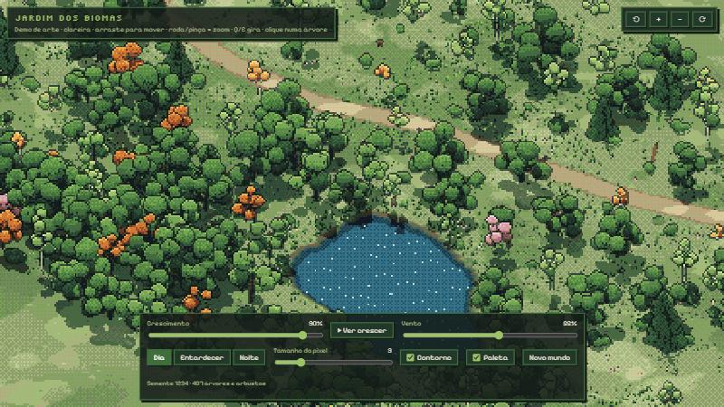
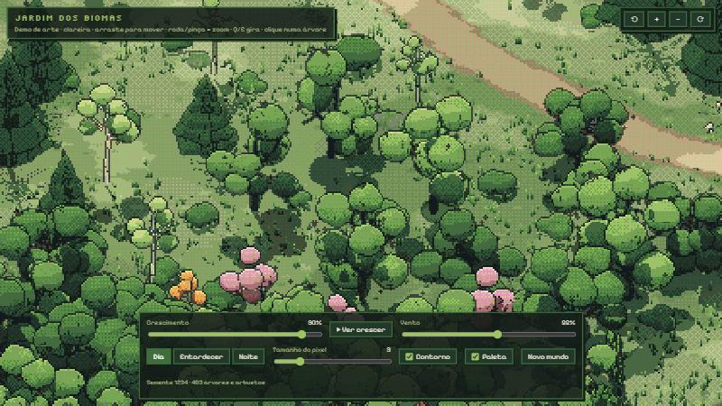
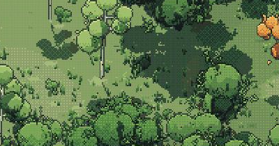
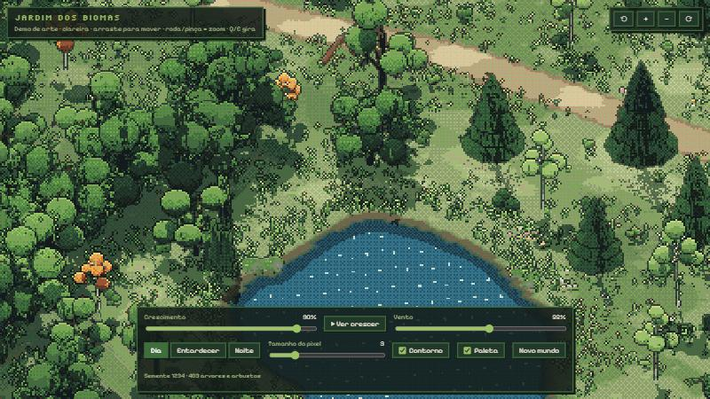
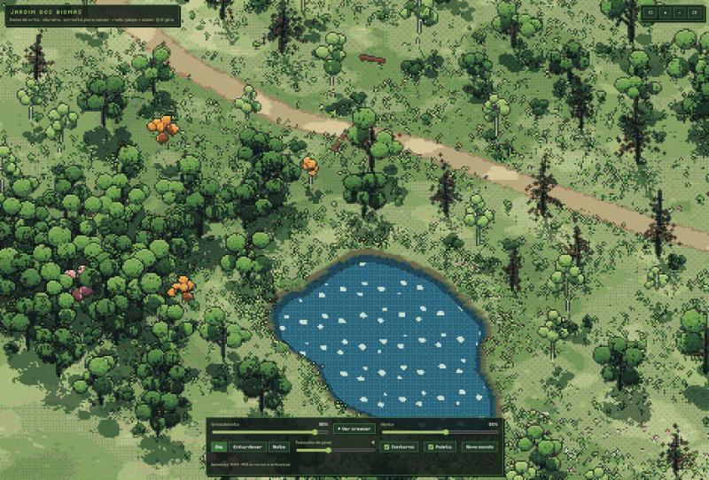
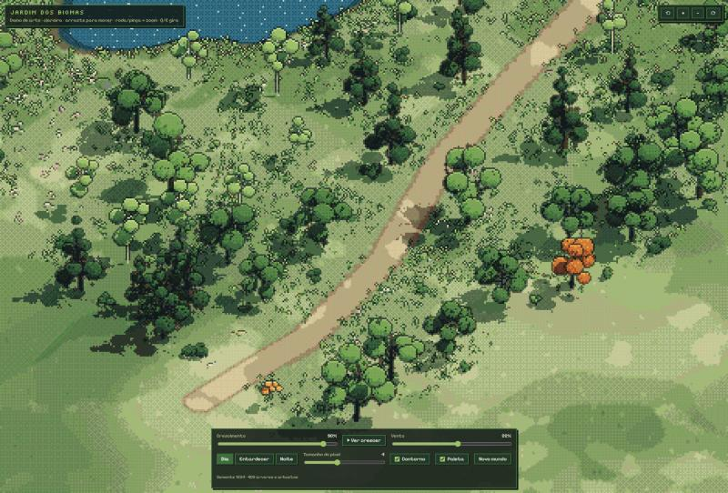

# Histórico do Jardim dos Biomas

Diário de desenvolvimento: o que mudou em cada versão, por quê, o que já funciona e o que ainda precisa de correção. Serve para acompanhar a evolução e planejar os próximos passos, por você, pelo Claude e pelo GPT.

**Como atualizar** (regra também no `AGENTS.md`):
1. Cada mudança relevante ganha uma entrada **no topo** da lista de versões, com data, motivo, o que mudou, uma captura de tela em `historico/` e o estado do que funciona ou falta.
2. O **Quadro atual** logo abaixo é mantido em dia: mova itens entre "Funciona", "Corrigir" e "Ideias".
3. Ao fechar uma versão, marque-a no Git: `git tag vX.Y && git push --tags`. No GitHub, *Tags* mostra cada versão e permite baixar ou comparar o código daquele momento.

Versão online: https://giovaniteixeira550-lab.github.io/jardim-dos-biomas/ · Página do histórico: [historico.html](historico.html)

---

## Quadro atual

### ✅ Funciona
- Pixel art de cena 3D: paleta fixa, contorno de 1 px, dithering, câmera ¾ que gira em passos de 45°.
- Clareira com bosque, lago de margem irregular, trilha, pedras, troncos, flores e capim.
- Árvores como **indivíduos** (número, espécie, estágio, tom), cada uma com a copa num corpo só.
- 8 espécies de árvore e arbustos, num catálogo de regras (`src/especies.js`).
- **Ecossistema:** umidade do solo, luz, altitude, nicho por espécie e competição por luz, que resultam no vigor de cada árvore.
- Crescimento muda → jovem → adulta, vento em degraus de pixel, dia, entardecer e noite com vaga-lumes.
- Clicar numa árvore mostra a ficha dela (espécie, estágio, solo, luz, vigor).

### 🛠 Corrigir / melhorar
- Salgueiros ainda raros: a margem do lago é estreita. Avaliar um lago maior ou uma área alagada.
- Borda dos cones do pinheiro pouco serrilhada vista de cima.
- O primeiro carregamento demora uns 20 s, por causa do download do motor 3D. Avaliar uma mensagem de "primeira vez" ou um pré-carregamento.
- Clique entre os lóbulos de uma copa às vezes não seleciona a árvore.

### 💡 Ideias (avaliar antes de fazer)
- **Tempo do ecossistema:** sementes caem perto das árvores-mãe; a sucessão faz bétulas abrirem espaço para carvalhos ao longo das "estações".
- Fauna: pássaros e borboletas como sprites de pixel, atraídos por flores e água.
- Chão: folhas caídas sob o bosque, trevos, pedrinhas na trilha.
- Água: juncos, nenúfares e espuma de 1 px na margem.
- Ligar o crescimento aos estudos reais (ver `docs/jardim-pesquisa-e-plano.md` no site).

---

## Versões

### v0.5 — Ecossistema (14/10/2026)
**Por quê:** pedido de que o jogo funcione como um ecossistema, com regras físicas e geográficas reais, sem perder o lado artístico.
**O que mudou:**
- `src/ecossistema.js`:
  - **umidade do solo** (perto d'água e em vales, drenada por declive), **altitude relativa** e **luz potencial**;
  - **aptidão** de cada espécie ao lugar pelo seu nicho, e a espécie que nasce é sorteada pela aptidão;
  - **competição por luz:** copas vizinhas mais altas sombreiam, mais ainda do lado do sol, e isso define o **vigor**.
- O vigor muda o tamanho final e a velocidade de crescimento.
- Nichos inspirados na ecologia real: salgueiro em solo encharcado, pinheiro em solo seco e alto, bétula pioneira de luz, carvalho tolerante à sombra, freixo de fundo de vale.
- Mata ciliar na beira do lago.

**Resultado:** a distribuição das espécies segue o terreno. Os arbustos de sub-bosque têm o maior vigor (0,90) e os pinheiros sofrem na clareira úmida (0,57).

### v0.4 — Árvores como indivíduos (14/10/2026)
**Por quê:** uma árvore parecia uma "muda acoplada": a massa da copa ficava parada enquanto as folhas balançavam. O pedido foi que cada árvore exista por si, com regras de árvore, sem pesar o jogo.
**O que mudou:**
- Catálogo de espécies (`src/especies.js`).
- Cada árvore é um indivíduo com vaga própria no desenho instanciado.
- Copa = um volume irregular único, sem cartões de folhas, com galhos e copa sob o mesmo vento.
- Arbustos procedurais leves que não nascem colados a troncos.
- Clique mostra a ficha da árvore.

### v0.3 — Capim sem "tentáculos" (14/10/2026)
**Por quê:** o capim parecia ter tentáculos que cresciam e diminuíam.
**Causa:**
- lâminas finas se movendo menos de 1 pixel;
- contorno de tinta que piscava nas pontas.

**O que mudou:**
- Vento em degraus de pixel inteiro.
- Capim sem contorno e mais lento.
- Lâminas mais grossas.

### v0.2 — Silhuetas por espécie (14/10/2026)
**O que mudou:**
- Pinheiro em camadas de cones.
- Carvalho largo e lobado.
- Bétula com casca branca marcada.
- Salgueiro com galhos pendentes.
- Tom de cada árvore em degraus.
- Correção: o carregamento não para mais com a aba oculta.

### v0.1 — Base: pixel art de cena 3D (14/10/2026)
**Decisão de arte:**
- O mundo 3D é renderizado como pixel art: baixa resolução, paleta de cerca de 40 cores, dithering e contorno.
- Isso responde ao receio de a pixel art "ficar só em 2D": a câmera gira e mostra o volume.
- Escopo reduzido a uma clareira de 180 × 120 m.

**Antes disso:** versões 2D desenhadas por código ("planas como papel") e 3D com texturas realistas ("sem lado artístico") foram descartadas.

