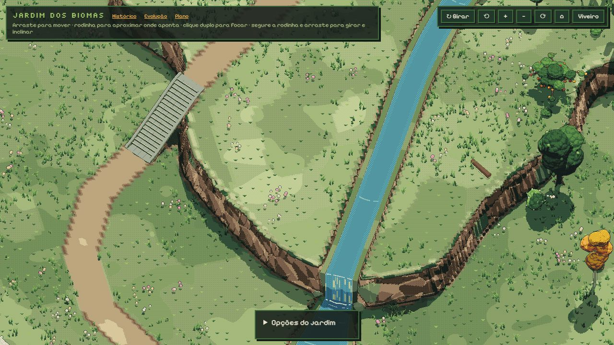

# Navegação do mapa — proposta para revisão

O usuário considerou insuficiente o ganho da resolução e pediu priorizar a observação e o movimento, sem atalhos para lugares. Todo o trabalho continua na demo artística isolada; o site e os geradores de espécies não foram alterados.

## Controles

- Botão esquerdo e arraste: o chão acompanha o cursor. O ponto tocado ancora um plano horizontal à altura do terreno, evitando o deslocamento aproximado que variava com a orientação.
- Segurar a rodinha e arrastar: esquerda/direita gira; cima/baixo inclina, no mesmo gesto. Inclinação limitada a 20–75°.
- Ativar **↻ Girar**: o botão esquerdo passa a girar e inclinar. Desativar devolve o deslocamento. Assim o botão direito e o do meio são opcionais.
- Rodinha: zoom mantém o ponto indicado no lugar, respeitando os limites do mapa. Unidades de rolagem por linha/página são normalizadas.
- Clique duplo: aproxima suavemente a árvore ou região escolhida. O novo alvo também é o centro do giro. Respeita a preferência por movimento reduzido; uma nova interação interrompe a animação.
- Casa: volta à visão geral. Controles anteriores de teclado e botão direito continuam compatíveis.
- **Opções do jardim** começa recolhido, liberando a paisagem. Crescimento, horário e comparação de definição continuam dentro dele.

## Verificação

`testes/camera.html` passou: arraste em quatro orientações e duas inclinações, ponto preservado no zoom, giro/inclinação combinados pelos dois modos, término/interrupção do foco e retorno à visão geral. Também verifica ausência de erros WebGL. Resultados em [camera-verificacao.txt](camera-verificacao.txt). Eventos sintéticos cobrem as combinações de botões; somente nesse teste a captura de ponteiro é substituída porque não existe um mouse físico ativo nesses eventos.

Na página principal foram realizados arrastes reais do navegador, troca do modo Girar, giro/inclinação com botão esquerdo e clique duplo, com inspeção visual. Console sem avisos ou erros. Botão do meio coberto pelo teste sintético, sem ensaio físico de mouse. A ancoragem do arraste usa o plano na altura inicial; não é uma caminhada com colisões no relevo. Nas bordas, os limites do mapa prevalecem sobre a ancoragem do cursor. Gestos multitoque anteriores foram preservados, sem validação em aparelho físico nesta etapa.

