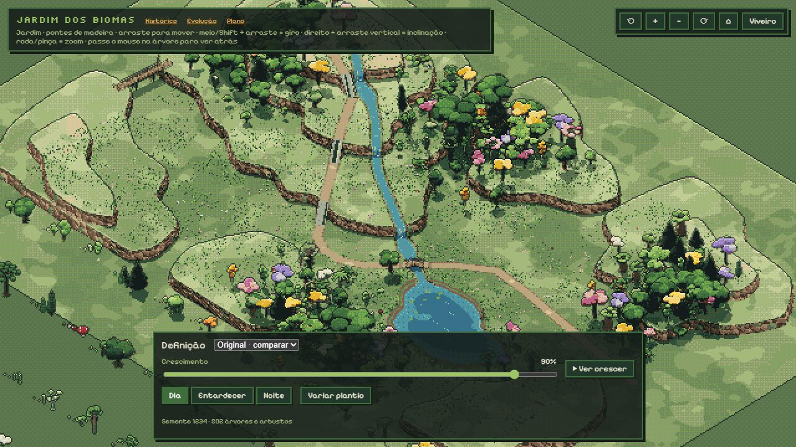
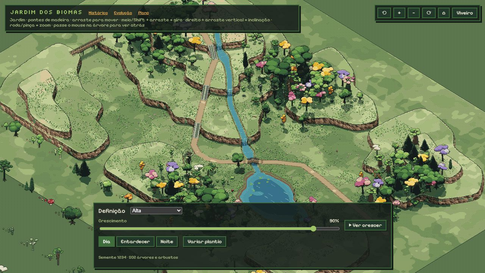

> Atualização de 18/10/2026: esta revisão foi reunida para publicação na demo v0.36. As referências a prévia não publicada abaixo descrevem o histórico anterior.

# Nitidez do mapa — proposta local

Pedido: melhorar a qualidade em distâncias médias e gerais na demo artística, priorizando qualidade sobre peso. A prévia antiga do site foi excluída deste trabalho por orientação do usuário.

## Comparação

Mesma semente 1234, crescimento 90%, horário diurno, câmera inicial e janela 1280 × 720.

O alvo intermediário antigo tinha apenas 640 × 360 pixels: detalhes menores se fundiam antes de chegar à tela. Alta usa 1280 × 720 e saída 2560 × 1440. Não se aplicou filtro artificial de nitidez, desfoque nem aumento de saturação. Contorno, quantização e sombras duras permanecem. O bloco de dois pixels passa a ocupar aproximadamente um pixel CSS; o modo Original preserva o aspecto anterior para comparação.

## Custo e limites

São quatro vezes mais pixels no alvo de cena, na saída e no mapa de sombras. Isso aumenta o uso de GPU e memória gráfica enquanto a demo está aberta. Não aumenta o tamanho de arquivos de textura baixados. A saída tem teto de 16 milhões de pixels e tamanho limitado pela GPU; em janelas muito grandes o fator pode ficar abaixo de 2. Não há redução automática por taxa de quadros. O modo Original oferece retorno manual sem reconstruir o bosque.

## Verificação

`node --test testes/qualidade.test.mjs` verifica resoluções, proporções, blocos pares e limites em janelas pequenas, grandes e GPU limitada.

`testes/nitidez.html` carrega a cena real com prazo, compara quatro alternâncias de qualidade com 90 intervalos de quadros por amostra, confere enquadramento, contorno, paleta, ausência de erro WebGL e executa dia/noite, zoom e giro. A medição usa requestAnimationFrame com aba visível; não é tempo isolado de GPU e não representa todos os aparelhos.

Execução local em 18/10/2026: passou com 502 árvores e arbustos. Nas duas amostras de cada modo, mediana de 12,5 ms; percentil 95 de 18,7 ms no Original e 18,7–18,8 ms no Alta. Console sem avisos ou erros. Resultado completo em [nitidez-verificacao.txt](nitidez-verificacao.txt). Testes de dimensões: 2 aprovados. Inspeção visual realizada na vista inicial, após duas aproximações e à noite; a comparação da vista inicial mantém a mesma câmera. Esses números não provam ausência de custo de GPU em outros aparelhos ou resoluções.

## Integração futura

Base v0.33 (`5c7ad2d`), branch `codex/nitidez-mapa`, em worktree próprio. Arquivos de execução: novo `src/qualidade.js`, blocos de resolução/sombras em `src/cena.js`, seletor em `index.html` e ligação em `src/main.js`. Nenhum gerador, catálogo ou regra de crescimento foi modificado. Ao combinar com o trabalho do Claude, preservar suas mudanças e conciliar README e histórico por entrada; não substituir arquivos inteiros. Publicação depende da revisão visual desta proposta.
