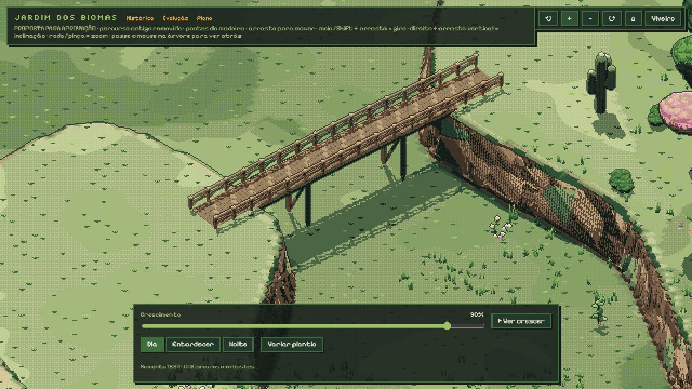
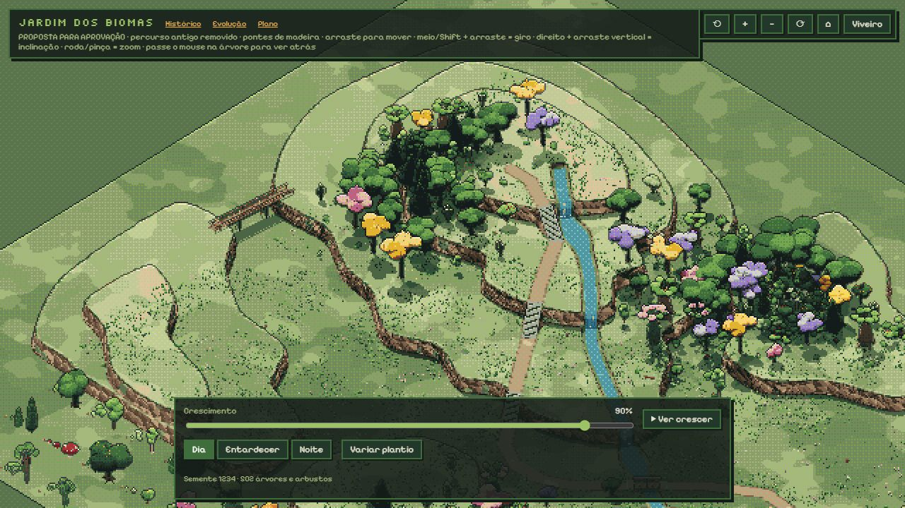

# Proposta local de pontes de madeira

Aguardando aprovação do usuário. Não publicada; GitHub Pages permanece na v0.22.

O desenho mais recente do usuário indica uma travessia curta entre a encosta do poente e a saia da crista. As cabeceiras canônicas são −8/73 e −6/53,5, ambas no patamar de aproximadamente 4,5 m; o vão total no mundo mede cerca de 27,8 m. O tabuleiro tem 2,8 m de largura e arqueamento discreto de 0,24 m. São 390 pequenas peças de tabuleiro, com vigas, apoios e guarda-corpos; a ponte inteira é reunida numa malha. A geometria é subdividida em faces com arestas menores que 0,55 m. A paleta, o pixel 2, a iluminação toon e o contorno continuam os existentes.

O percurso de −5/88 até a crista, com suas escadas ocidentais, foi removido. O caminho principal agora começa no mirante 25/24; a subida pelo lado das cascatas permanece e pode servir para descer. A ponte inferior recebeu o mesmo material de madeira, com tabuleiro plano e apoios só nas cabeceiras, preservando a passagem da água.

O jardim de chegada mantém sua reserva; seu acesso foi marcado para replanejamento, pois o caminho anterior foi explicitamente removido. Nenhum novo acesso foi inventado para substituir o trecho que o usuário rejeitou. A integração visual da nova ponte na planta de cima pode ser concluída após a aprovação da posição.

Verificação: 55 testes de terreno e percursos passaram. A chegada continua verificada como reserva plana e sem árvores, com seu acesso explicitamente pendente. Cinco verificações no navegador cobrem as pontes de madeira, a remoção do caminho, apoio das cabeceiras, vão livre, tamanho das faces e altura do tabuleiro. Prévia de perto e do conjunto conferida visualmente, sem erros.

Conferência final adicional: seis verificações do relevo no navegador passaram, com 69 pisos e 138 posições laterais de escadas, altura da ponte, cascatas, renderização e liberação dos recursos.
